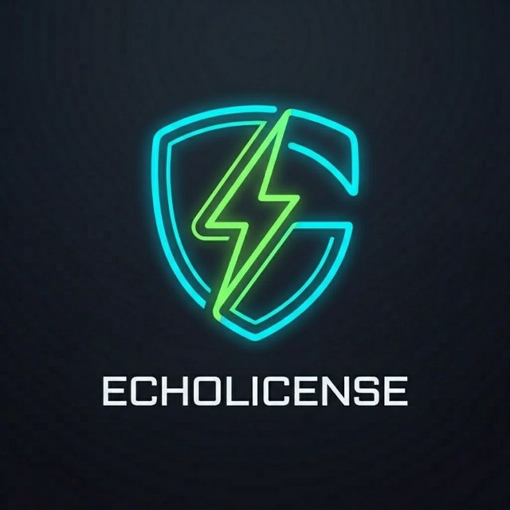

<div align="center">
  

  # Echolicense VPN (V2Echo)

  **Modern Cross-Platform VPN Client for Android & Windows PC**
  *Liquid Glass UI • Full TUN Mode • WireGuard Gaming • AI Pro • Smart DNS & Auto-MTU*

  [](https://github.com/Rockst4r4/V2Echo/releases/latest)
  [](#downloads)
  [](https://t.me/echopress_bot)
</div>

---

## Overview

**Echolicense VPN** is a modern, high-performance VPN client built for stability on restricted networks. Featuring an iOS 27-inspired **Liquid Glass** interface with an ExpressVPN-style layout, it unifies **Xray / sing-box** protocols (`VLESS`, `VMess`, `Trojan`) alongside **WireGuard** in a bilingual (`EN` / `FA`) experience for **Android** and **Windows PC**.

---

## Downloads (v1.7 Official Release)

Download the latest signed binaries from **[GitHub Releases](https://github.com/Rockst4r4/V2Echo/releases/latest)**:

| Platform | File | Notes |
|---|---|---|
| **Android (APK)** | `Echolicense-Android-v1.7.apk` | Signed Release APK (Android 8.0+ / API 26+) |
| **Android (Play Store)** | `Echolicense-Android-v1.7.aab` | Signed App Bundle ready for Google Play Console |
| **Windows PC (64-bit)** | `Echolicense-Windows-v1.7.zip` | Portable package (`EcholicenseVPN.exe` + `sing-box` + `Wintun` + `WireGuard-NT`) |

---

## Feature Comparison

| Feature | Android | Windows PC |
|---|:---:|:---:|
| **Protocols (`VLESS`, `VMess`, `Trojan`, `WireGuard`)** | Full TUN (`Xray-core`) | `sing-box` + Native `WireGuard-NT` |
| **Connection Modes** | Full TUN | TUN Mode + System Proxy |
| **Live Real Tunnel Ping (`HTTP/TCP 204` + Sparkline)** | TCP Smart Ping | Live Real Ping Monitor + Kernel WG ICMP |
| **AI Pro Exclusive Mode** | Yes | Yes |
| **Gaming Mode (Minimal Red • WireGuard)** | Yes | Yes (Kernel TUN Real Ping) |
| **Bypass Iran (Sites, Banks & IPs)** | Default 40+ Apps + `geoip/geosite` | Main Toggle + `.ir` & `geoip-ir/geosite-ir` |
| **Graphical Split Tunneling** | Auto App Bypass | Visual Checklist + Add `.exe` (Bypass / Only) |
| **KillSwitch (Leak Protection)** | Android VPN Lockdown | Main Toggle (Windows Firewall Rules) |
| **Smart Auto-Failover DNS & Manual DNS** | IPv4 & DoH | IPv4 & DoH |
| **Auto-MTU Optimizer & Manual MTU** | 1200–1500 | 1200–1500 |
| **AdBlocker (Ads, Trackers & YouTube Ad Domains)** | Yes (AdGuard DNS + Rules) | Yes (AdGuard DNS + Rules) |
| **Mux Mode (Multiplexing)** | Configurable Concurrency & XUDP | Configurable Concurrency |
| **Multi-Subscription & 12h Auto-Sync** | Yes + Offline QR Scanner | Yes |
| **HWID Reporting (`x-hwid`, OS, Model)** | Yes | Yes |
| **Traffic Quota & <5 GB Low-Traffic Alert** | Card + Background Notification | Live Card + Auto-Sync |
| **Dynamic Announcements & Promo Codes** | Banner + Push Notification | Live Banner + One-Click Copy |
| **Quick Access & Startup** | One UI Quick Settings Tile | Startup App + Auto-Connect |
| **Languages (`English` Default / `فارسی` RTL)** | Yes | Yes |

---

## Quick Start

### Android
1. Install `Echolicense-Android-v1.7.apk` *(uninstall any older Debug build first)*.
2. Tap **Subs** or the **QR Scanner** icon to import your subscription link, `vless://` URI, or WireGuard config.
3. Tap the central power button to connect, or add the **Echolicense** tile to your Quick Settings panel.

### Windows PC
1. Extract all files from `Echolicense-Windows-v1.7.zip` into a folder.
2. Run `EcholicenseVPN.exe` and accept Administrator privileges *(required for TUN Mode, WireGuard-NT, and KillSwitch)*.
3. Open **Subs** to add your subscription link, choose **TUN Mode** or **System Proxy**, and click the power button.
4. Click the status text under **Echolicense** anytime to inspect or copy live core logs.

---

## Dynamic Announcements & Promo Codes

Push banners, notices, and discount codes to all Android and Windows users without rebuilding by editing **`announcements.json`** and incrementing `"id"`:

```json
{
  "id": 2,
  "active": true,
  "title": "Special Weekend Offer",
  "message": "Use the promo code below in our Telegram bot to get 20% off:",
  "promo_code": "ECHO20",
  "button_text": "Open Bot",
  "action_url": "https://t.me/echopress_bot",
  "bot_username": "echopress_bot"
}
```

Set `"active": false` to hide the banner for all clients.

---

## معرفی کوتاه (فارسی)

<div dir="rtl">

**اکولایسنس (Echolicense VPN)** یک کلاینت اختصاصی و مدرن برای **اندروید** و **ویندوز (PC)** با طراحی شیشه‌ای **Liquid Glass** است که تمام پروتکل‌های پرکاربرد (`VLESS`، `VMess`، `Trojan` و `WireGuard`) را با حداکثر پایداری روی اینترنت ایران اجرا می‌کند.

- **حالت اختصاصی AI Pro و گیمینگ (WireGuard):** اتصال تک‌کلیک به سرورهای هوش مصنوعی یا سرورهای گیمینگ با پینگ واقعی.
- **بایپس خودکار ایران و Split Tunneling گرافیکی:** باز شدن مستقیم سایت‌ها، بانک‌ها و اپلیکیشن‌های ایرانی بدون قطع VPN.
- **DNS خودکار هوشمند و Auto-MTU:** انتخاب خودکار سریع‌ترین DNS سالم و بهینه‌ترین MTU برای اینترنت فعلی کاربر (همراه با تنظیم دستی).
- **مدیریت چند اشتراک، HWID و نمایش حجم:** پشتیبانی از چند لینک اشتراک، ثبت خودکار HWID در پنل، بروزرسانی خودکار هر ۱۲ ساعت و هشدار اتمام حجم زیر ۵ گیگابایت.
- **امکانات اختصاصی ویندوز:** حالت‌های `TUN Mode` و `System Proxy`، نمایشگر زنده **Real Tunnel Ping**، دکمه **KillSwitch** در صفحه اصلی، اجرای خودکار با ویندوز (`Startup App`) و اتصال خودکار (`Auto-Connect`).
- **پشتیبانی و تمدید سریع:** [@echopress_bot](https://t.me/echopress_bot)

</div>
